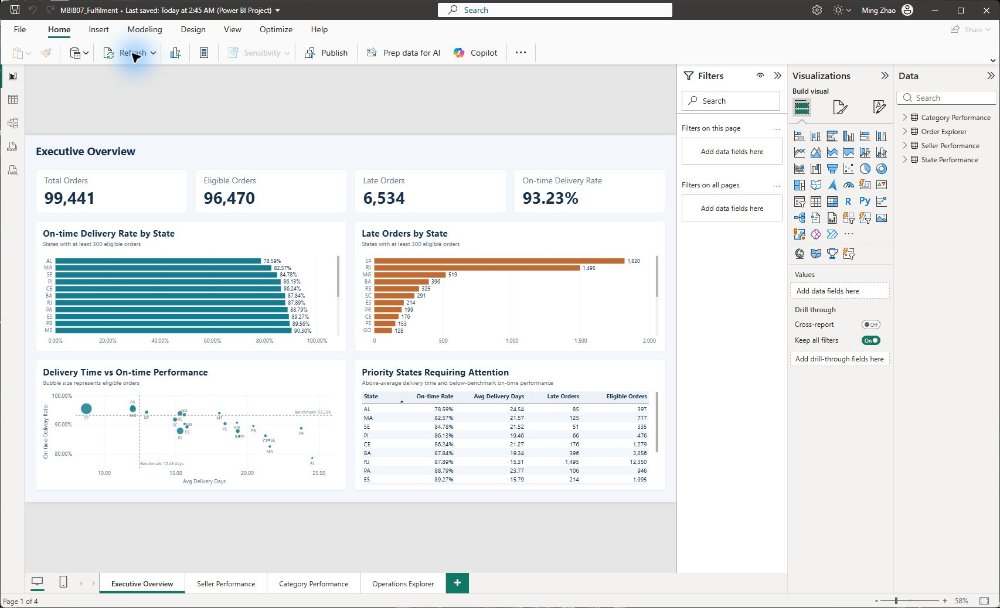
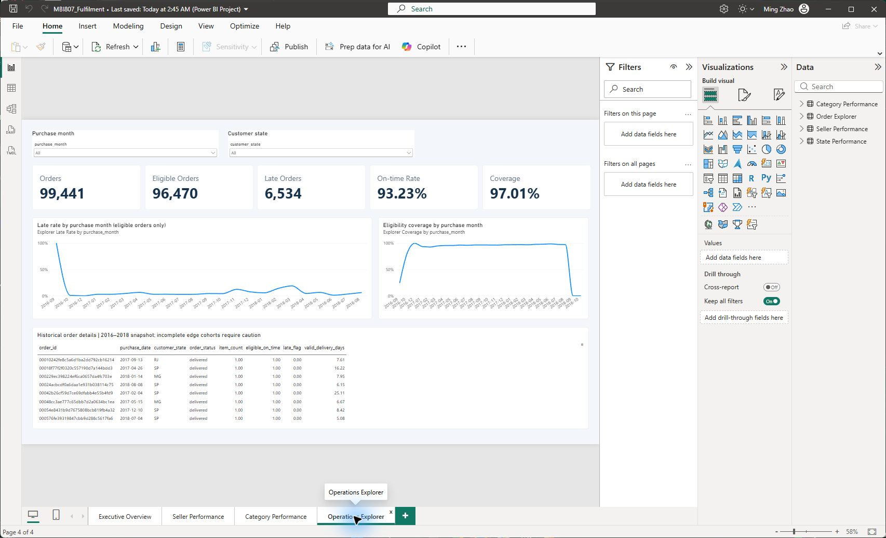

# Olist fulfilment BI

**A reproducible order-fulfilment analytics portfolio using Python, SQL and Power BI.**

This project turns Olist's anonymised Brazilian e-commerce records into a constrained
SQLite warehouse and an interactive fulfilment report. It examines late delivery,
delivery duration, regional differences, seller performance, product categories
and order-level coverage. The findings describe historical records; they do not
claim measured operational improvements or predict future delivery failures.



## Explore the project

- [Written report (PDF)](Reports/Olist_Fulfilment_BI_Report.pdf)
- [Editable report (Word)](Reports/Olist_Fulfilment_BI_Report.docx)
- [Power BI report snapshot](TechnicalPortfolio/03_Dashboards/MBI807_Fulfilment.pbix)
- [Editable Power BI project](TechnicalPortfolio/03_Dashboards/MBI807_Fulfilment_Project/MBI807_Fulfilment.pbip)
- [SQL schema](TechnicalPortfolio/01_Database/schema.sql) and [analytical views](TechnicalPortfolio/01_Database/analytical_views.sql)
- [Validation code](TechnicalPortfolio/02_ETL_Code/validate_solution.py)
- [Publication verification record](docs/verification.json)

The written report is preserved as a historical analysis snapshot. Statements
about coursework submission or recording status refer to that snapshot; the
current publication verification is documented below.

## Business question

Where should a fulfilment analyst investigate delivery performance, and how do
regional, seller and category results change when the denominator and eligibility
rules are defined correctly? The dashboard supports investigation and comparison.
It does not infer that sellers or regions caused a delay from descriptive data alone.

## Verified snapshot

| Metric | Result |
|---|---:|
| Orders | 99,441 |
| Order items | 112,650 |
| Customers | 99,441 |
| Products | 32,951 |
| Sellers | 3,095 |
| Delivered orders | 96,478 |
| Eligible orders for on-time and duration metrics | 96,470 |
| Late eligible orders | 6,534 |
| On-time rate | 93.23% |
| Overall order-weighted mean delivery duration | 12.56 days |

Eight delivered orders lack the delivery date needed for those metrics. They remain
in the data for coverage, but are excluded from calculations requiring that date.
Late delivery compares actual and estimated **calendar dates**. Clean timestamps
use minute precision; the original CSVs retain seconds.

**Why the dashboard can show 12.48 days while the report shows 12.56 days:** the state
scatter benchmark uses only plotted states with at least 300 eligible orders.
The overall mean includes all eligible orders. Both use order weights within their
stated cohorts. Averaging state means equally would give 18.78 days and answer a
different question, giving a small state the same weight as a large state.

## Technical approach

1. Preserve six related source CSVs and their provenance.
2. Clean types, handle missing values and retain quality flags in Python.
3. Load five business tables with primary keys, foreign keys and CHECK constraints.
4. Aggregate at the correct grain before joining or calculating business metrics.
5. Export validated CSV inputs for the Power BI model and order explorer.
6. Record full-refresh runs and test constraints, restoration and reconciliation.

The database relationships separate orders, order items, customers, products and
sellers. The order-level analytical view avoids counting a multi-item order more
than once in delivery metrics. The solution uses full refresh; it does not implement
incremental change capture.

## Run the pipeline

The six required original CSVs are included under
`TechnicalPortfolio/04_Data_Examples/03_Raw_Dataset`. Source attribution and hashes
are recorded alongside them. A fresh build generates the SQLite database, the SQL
restoration dump and cleaned row-level extracts; those generated copies are ignored
by Git to keep the repository manageable.

Python 3.11 or newer is required. The current relocated-copy verification used
Python 3.12.14, pandas 3.0.1 and NumPy 2.3.5. Installing dependencies requires network
access; subsequent processing runs against the local supplied CSVs.

From the repository root on Windows:

```powershell
cd TechnicalPortfolio
python -m venv .venv
.\.venv\Scripts\python.exe -m pip install -r 02_ETL_Code\requirements.txt
.\.venv\Scripts\python.exe 02_ETL_Code\audit_run.py
.\.venv\Scripts\python.exe 02_ETL_Code\prepare_powerbi.py
.\.venv\Scripts\python.exe 02_ETL_Code\build_explorer.py
.\.venv\Scripts\python.exe 02_ETL_Code\validate_solution.py
```

Expected business-table counts: 99,441 orders, 99,441 customers, 112,650 order items,
32,951 products and 3,095 sellers. The validation script checks reconciliation,
foreign keys, constraint failures, duplicate-key rollback and exact SQL restoration.

## Open and refresh Power BI

The `.pbix` includes an imported historical snapshot and can be opened in Power BI
Desktop for viewing. It contains Executive Overview, Seller Performance, Category Performance
and an Operations Explorer for order-level filtering.

After cloning or moving this repository, run **both** `prepare_powerbi.py` and
`build_explorer.py`. Then open the `.pbip` project in Power BI Desktop, refresh and
save a new `.pbix`. These scripts rewrite all four CSV paths in the editable project;
they do not refresh or change the stored source paths in an existing PBIX.
The committed editable project uses a neutral `C:/Portfolio/olist-fulfilment-bi`
placeholder until those preparation steps run. Keep the project folders together.



## What was verified

A separate copy in a Windows path containing spaces ran all four documented entry
points successfully. All five rebuilt tables and four analytical views matched the
original at exact value level. Independent arithmetic, SQLite integrity and foreign
key checks also passed. A January 2018 / RJ filter reconciled 893 orders, 850 eligible
orders and 111 late orders.

This publication review used the bundled Python environment on one Windows computer.
It did not repeat a fresh isolated-environment installation or native Power BI refresh
on another computer. Earlier native Power BI acceptance is historical evidence;
the current PBIX hash is recorded separately. Report screenshots show actual Power BI
output. See `docs/verification.json` for the precise scope.

## Repository contents

```text
Reports/                  Written report, editable Word and PDF
TechnicalPortfolio/
  01_Database/            SQL schema, analytical views and relationship diagram
  02_ETL_Code/            Cleaning, full refresh, preparation and validation code
  03_Dashboards/          PBIX, editable PBIP and Power BI screenshots
  04_Data_Examples/       Original CSVs, provenance, samples and aggregate examples
docs/                     Verified metrics and publication-review scope
DATA_LICENSE.md           Dataset attribution and license scope
```

Generated databases, the large SQL data dump, full cleaned extracts, temporary
files, course handouts, duplicate backups and original course recordings are not
part of this public copy. The runnable code rebuilds the database and derived data.
The original local assignment files are preserved.

## Data attribution and use

Data: **Brazilian E-Commerce Public Dataset by Olist**, published by Olist on
[Kaggle](https://www.kaggle.com/datasets/olistbr/brazilian-ecommerce).
The retained publisher metadata identifies [CC BY-NC-SA 4.0](https://creativecommons.org/licenses/by-nc-sa/4.0/).
Keep attribution, identify adaptations and follow its noncommercial and share-alike
terms. Dataset-derived CSVs, figures and the imported Power BI dataset retain those
terms. See [DATA_LICENSE.md](DATA_LICENSE.md); the data is not placed under an
unrestricted software license. Olist does not endorse this project.

Project author: **Ming Zhao**.
